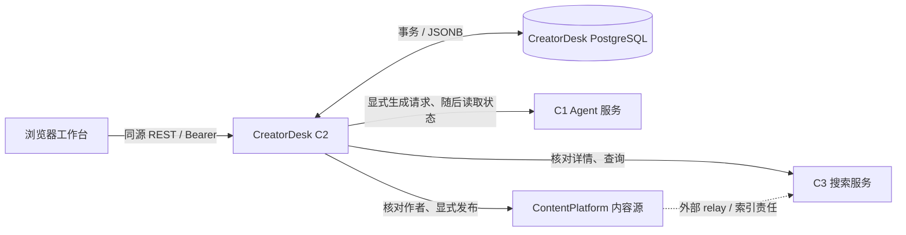

# CreatorDesk 架构与源码地图

## 组件流

C2 不共享 peer 数据库，不启动外部服务，也不运行后台发布/索引同步器。C1、ContentPlatform 和 C3 的实现不在本仓库。

## 事务和所有权

- `SecurityConfig` 使用 `OwnerRegistry` 校验 Bearer。owner 只由 token 映射产生；请求 body 不能选择 owner。配置 token 的摘要用于认证比对，原 token 不写入事件或错误信息。
- `desk_tasks` 以 `(owner, task_id)` 为键保存 JSONB 聚合和单调 `revision`；`DeskStore.change` 在事务内按旧 revision 更新，竞争失败返回冲突。事件写入同一事务。
- `desk_events` 有 owner/task 外键和序号索引。应用启动取得 PostgreSQL advisory lock，确保同一数据库仅运行一个 CreatorDesk Java 实例；它不提供分布式租约或高可用。
- Flyway 的 `V1__creator_desk.sql` 建立 task 与 event 表。当前 Java 列表接口没有分页，并返回 owner 下任务集合。

## 版本、审核、生成与发布

1. `CreatorWorkflow.addSource` 记录操作者提交的 title、URL 与 excerpt；不会抓取 URL 或自动核实来源。
2. `saveVersion` 固化版本正文和来源引用，按 `base_version` 拒绝过时修改。
3. `review` 将审核绑定到指定版本；批准需要显式来源核对确认。保存新版本后必须重新审核。
4. `generate` 先保存生成意图和幂等 ID，再通过 C1 创建 session/run；后续同步显式读取状态。CreatorDesk 不把发布凭据传给 C1。
5. `previewPublication` 固化完整发布正文、hash、作者目标和审核版本。只有显式确认才向 ContentPlatform 写入；不确定结果保留为 `unknown`。
6. `reconcilePublication` 通过 C3 只读核对内容 ID、正文、作者和公开状态。只有显式 `retry` 才重用原 publication ID、正文和幂等键；这依赖目标平台的幂等合同，不构成任意 peer 下的 exactly-once 保证。

## HTTP peer 合同

| Peer | CreatorDesk 使用的路径 | 责任 |
|---|---|---|
| C1 Agent | `POST /v1/sessions`、`POST /v1/sessions/{id}/runs`、`GET /v1/runs/{id}`、`GET /v1/runs/{id}/events` | 接收显式生成请求，返回 run 与事件。 |
| ContentPlatform | `GET /v1/me`、`POST /v1/content` | 提供配置作者身份；按固定幂等键创建公开内容。 |
| C3 搜索 | `GET /v1/content/{id}`、`GET /v1/search?q=...&limit=...` | 提供源端详情核对与搜索读取。 |

Peer 客户端对请求/响应大小、请求时限和响应字段设限，不跟随重定向，不自动重试不确定的写入。敏感配置从运行环境提供。外部 API 是独立部署合同；本包不能替代它们。

## API 与源码地图

| 代码 | 位置 | 职责 |
|---|---|---|
| `CreatorDeskApplication` | `backend-java/src/main/java/org/creatordesk/CreatorDeskApplication.java` | Spring Boot 入口。 |
| `CreatorDeskController`, `BodyRules` | `.../api/` | `/api` REST 路由、字段与路径检查。 |
| `CreatorWorkflow` | `.../service/CreatorWorkflow.java` | 业务状态转换与 peer 编排。 |
| `DeskStore` | `.../persistence/DeskStore.java` | 事务、JSONB 聚合、revision compare-and-set、事件和 advisory lock。 |
| `OwnerRegistry`, `OwnerConfig`, `SecurityConfig` | `.../config/` | owner 与凭据映射、Bearer 身份。 |
| `PeerClients`, `PeerHttp`, `PeerDirectory` | `.../peer/` | C1、ContentPlatform、C3 HTTP 客户端和边界。 |
| 数据库迁移 | `backend-java/src/main/resources/db/migration/V1__creator_desk.sql` | task/event schema。 |
| 内置页面 | `backend-java/src/main/resources/static/` | 同源 `index.html`、`app.js`、`styles.css`。 |
| PostgreSQL 集成测试 | `backend-java/src/test/java/org/creatordesk/persistence/CreatorDeskPostgresIntegrationTest.java` | 实际 PostgreSQL、REST、owner 隔离和状态恢复检查；需要独立测试库。 |

关键路由包含 `GET/POST /api/tasks`、`GET /api/tasks/{taskId}`、`POST .../sources`、`POST .../versions`、`POST .../reviews`、`POST .../generations`、生成 `sync/events`、发布 `preview/confirm/retry/reconcile` 及 `GET /api/search?q=...`。除 `/healthz`、静态页面和受限健康端点外，API 需要 CreatorDesk Bearer。
